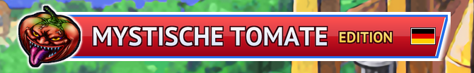

# Yu-Gi-Oh! GX Tag Force 1 — Europäischer HD- und Textkorrektur-Patcher

[English](README.md) · [Italiano](README.it.md) · [Français](README.fr.md) · [Deutsch](README.de.md) · [Español](README.es.md)

<p align="center"></p>

Ein kostenloser Open-Source-Patcher für **Yu-Gi-Oh! GX Tag Force** (PSP), europäische Version **ULES00600 v1.01**.
Aus *Ihrer eigenen* ISO erzeugt er eine Kopie in der gewählten Sprache (**Englisch, Französisch, Deutsch, Spanisch, Italienisch**) mit den Teilen, die Sie auswählen:

- **HD-Texturen** für PPSSPP: große und kleine Karten mit neu gezeichnetem Text in Ihrer Sprache, Oberflächentexte, Titelbanner;
- **Überarbeitung und Korrektur der Texte**: wo die Lokalisierung die Bedeutung des Originals verloren oder verändert hatte, werden Dialoge, Duellsprüche und Oberflächentexte aus der Originalsprache neu angepasst und übersetzt (auch Sätze, die in manchen Sprachen ganz fehlten), zusätzlich zu Tippfehlern, Akzenten, Leerzeichen und Resten anderer Sprachen;
- **Korrektur der Kartentexte**: Namen und Beschreibungen neu angepasst, wo die Übersetzung falsch oder unvollständig war, plus Tippfehler und Akzente;
- **Entfernen der anderen Sprachen**: kleinere ISO, das Spiel bleibt in der gewählten Sprache, egal welche Systemsprache die PSP hat, und die Sprachauswahl (Bildschirm beim ersten Start und Hauptmenüeintrag) entfällt, da sie überflüssig wäre.


Vom Patch geänderte Texte je Sprache (durch Vergleich der gepatchten ISO mit dem Original gezählt; die Zahlen umfassen jede Änderung, vom falschen Buchstaben bis zum komplett neu übersetzten Satz):

| Sprache | Karten | Dialogzeilen | Duellsprüche (einzigartig) | Oberflächentexte (einzigartig) |
|---|---:|---:|---:|---:|
| Englisch | 82 | 402 | 11 | 57 |
| Französisch | 266 | 467 | 51 | 254 |
| Deutsch | 258 | 1,649 | 40 | 581 |
| Spanisch | 624 | 601 | 55 | 329 |
| Italienisch | 181 | 2,488 | 33 | 298 |

> **Status: erste Version.** Die Patches sind für jede Modulkombination Datei für Datei geprüft, und alle fünf Sprachen wurden in PPSSPP getestet (Start, Titelbildschirm, Demo-Duelle). Story-Modus, Deck-Editor und Shop wurden noch nicht gründlich durchgespielt. Der grafische Installer ist neu: unter Windows getestet; die Linux-Version wird von GitHub Actions erzeugt und wurde noch nicht auf einem echten Linux-Desktop ausgeführt.

## Was Sie brauchen

- Ihre eigene **ULES00600 v1.01**-ISO (europäisch). MD5 des vollständigen Dumps: `719c99478032a4210ae877832061e9fd` ([redump.org](http://redump.org/)). Kopien ohne die letzten 2 KB Nullen werden ebenfalls akzeptiert.
- [PPSSPP](https://www.ppsspp.org/) mit aktivierter Option **Texturen ersetzen**; Render-Auflösung 4x empfohlen.

Dieses Repository **enthält weder das Spiel noch daraus extrahierte Daten**: Die Patches (`.tfp`) enthalten nur binäre Unterschiede zu den Originaldateien.

## Grafischer Installer (empfohlen)

1. Laden Sie von der Seite [Releases](../../releases) `tfpatch-gui.exe` (Windows) oder `tfpatch-gui-linux-x86_64` (Linux; zuerst `chmod +x tfpatch-gui-linux-x86_64` ausführen) herunter.
2. Starten Sie es. Das Programm öffnet sich in der Sprache Ihres PCs (Englisch, wenn sie nicht zu den fünf gehört) und zeigt das Banner *Mystische Tomate* der **Patch-Sprache**; standardmäßig ist sie die Programmsprache, lässt sich aber getrennt ändern.
3. Das Programm sucht Ihre ISO und Ihren PPSSPP-Datenordner selbst und zeigt nur das Ergebnis; findet es einen nicht, bittet es Sie, ihn zu wählen. Lassen Sie die Module an oder entfernen Sie Häkchen (standardmäßig sind alle aktiv). Pfade, Speicherort der fertigen ISO und eine neue Suche finden Sie unter **Erweiterte Optionen**. Die **endgültige ISO-Größe und die Größe des Texturpakets werden live angezeigt** und ändern sich, wenn Sie Module an- oder abwählen.
4. Klicken Sie auf **Installieren**. Patch und Texturmodule werden von den Releases heruntergeladen und geprüft (SHA-256); Ihre Original-ISO wird nie verändert.

**Windows-Warnung:** Das Programm ist nicht digital signiert, daher kann Windows SmartScreen „Der Computer wurde durch Windows geschützt“ anzeigen, und manche Virenscanner schlagen an. Klicken Sie auf **Weitere Informationen → Trotzdem ausführen**. Der Code ist öffentlich, und die Dateien in den Releases werden daraus von GitHub Actions gebaut.

Hinweise zu den Optionen:
- Ohne *Andere Sprachen aus dem Spiel entfernen* behält das Spiel alle fünf Sprachen und seine eigene Sprachauswahl; nur die Patch-Sprache erhält Korrekturen und HD-Texturen.
- *HD-Texturen* erzeugt eine separate `textures.zip` in `<PPSSPP-Datenordner>/PSP/TEXTURES/ULES00600/` (dieselbe Datei funktioniert unter Android: auf dem Telefon in denselben Pfad kopieren). Enthält dieser Ordner bereits ein anderes Texturpaket, verschieben Sie es zuerst.

## Kommandozeile

Das Kommandozeilenwerkzeug liegt den Releases nicht bei (die meisten brauchen nur den grafischen Installer): bauen Sie es mit `cd patcher/tfpatch && cargo build --release` (das Programm ist `target/release/tfpatch`). Patches, auf der Release-Seite herunterladbar: `patch_de.tfp`, `patch_en.tfp`, `patch_fr.tfp`, `patch_es.tfp`, `patch_it.tfp`.

```
tfpatch iso --iso ULES00600.iso --patch patch_de.tfp --out ULES00600_de.iso
tfpatch textures --lang de --out textures.zip
```

`tfpatch iso` akzeptiert `--no-cards`, `--no-text` und `--keep-languages` (die drei obigen Module, abgeschaltet) sowie `--dry-run` (gibt die endgültige ISO-Größe in Byte aus). `tfpatch textures` lädt `base.zip` und das Sprachmodul herunter, prüft deren SHA-256 und fügt sie zu einer einzigen `textures.zip` zusammen (bei `--out` einen Ordner angeben, um zu entpacken; mit `--source ORDNER` werden bereits heruntergeladene Dateien verwendet). Unter Linux geben Sie `./tfpatch` ein.

## Bekannte Einschränkungen

- Ein Spielstand, der in einer anderen Sprache als der des Patches erstellt wurde, wird nicht angepasst.
- Unter Linux braucht der grafische Installer `libxkbcommon-x11` (X11) oder die Wayland-Bibliotheken, die die meisten Desktops schon haben; sonst die Kommandozeile bauen und verwenden. Die Dateidialoge nutzen das Desktop-Portal; öffnen sie sich nicht, geben Sie die Pfade unter „Erweiterte Optionen“ ein.
- Unterstützt wird nur der Emulator PPSSPP (der Patch ersetzt ein Spielmodul in der ISO, und die Texturen sind PPSSPP-Ersatztexturen).
- Der Textur-Download beträgt etwa 1,4 GB pro Sprache: eine 313 MB große Basis für alle Sprachen (nur die Texturen, die jede Sprache braucht) plus ein Modul von etwa 1 GB mit den HD-Karten und der Oberfläche dieser Sprache.

## Probleme melden

Tippfehler, falscher Kartentext oder ein Fehler? [Eröffnen Sie ein Issue](../../issues/new/choose): Es gibt Formulare für Textfehler und für Programmprobleme, und Sie können in einer der fünf Sprachen schreiben. Hängen Sie niemals Ihre ISO oder Spieldateien an.

## So funktioniert es

1. `patcher/tools/build_modular_patch.py` baut für jede Sprache die ISO nur mit den Kartenkorrekturen, nur mit den Textkorrekturen und mit beiden und schreibt eine modulare `.tfp` (Format 2): ein Zip mit `patch.json` und bsdiff-Deltas, jedes mit den benötigten Modulen markiert (`cards`, `text`, `strip`).
2. `patcher/tfpatch` (Rust) prüft die MD5, wählt die Deltas der aktiven Module aus und schreibt die ISO kompakt: gleicher Header und gleiche Verzeichnisse, danach nur die noch benutzten Daten. Die endgültige Größe wird berechnet, ohne etwas zu schreiben – so zeigt sie der Installer live an.
3. Mit `strip` wird `libtitle.prx` geändert (`patcher/tools/remove_language_selector.py`), um Sprachbildschirm und Menüeintrag zu entfernen und die Sprache festzulegen; die Dateien der anderen Sprachen verweisen auf die Daten der gewählten Sprache.
4. `patcher/tools/build_texture_modules.py` erstellt `base.zip` (nur die Texturen, die jede Sprache braucht) und je Sprache eine `<Sprache>.zip` (die Texturen dieser Sprache); `patcher/tools/build_manifest.py` vervollständigt `manifest.json` (SHA-256, Patches, ISO-Größen).
5. `verify_modular_patch.py`, `compare_isos.py` und `verify_texture_pack.py` prüfen die Ergebnisse; `build_all_patches.sh SPRACHE...` baut und prüft jede Kombination neu.

Texte, redaktionelle Regeln und Korrekturen liegen in `tools/` (`corrections/`, `data/`). `docs/NEW_LANGUAGE_GUIDE.md`, `docs/EDITORIAL_CHOICES.md` und `docs/CHANGES_<LANG>.md` dokumentieren Methode und Entscheidungen (auf Italienisch).

## Aus dem Quellcode bauen

```
cd patcher/tfpatch && cargo build --release
```

Das baut sowohl `tfpatch` (Kommandozeile) als auch `tfpatch-gui`. Unter Linux braucht die grafische Oberfläche die üblichen X11-/Wayland-/OpenGL-Entwicklungspakete.

## Danksagungen

- **MikeyMK** — *Yu-Gi-Oh! GX Tag Force 1 HD Remastered* (Grundlage der HD-Texturen, US-Version).
- **chrisfand** — HD-Karten.
- Freie Schriften (OFL): XCharter, Libre Baskerville, Newsreader, Alegreya und weitere, heruntergeladen mit `tools/alt_fonts/download_fonts.sh`.

Inoffizielles, nicht kommerzielles Fanprojekt, nicht mit Konami verbunden. *Yu-Gi-Oh!* ist eine Marke von Konami.

## Lizenz

Der Code steht unter der [MIT-Lizenz](LICENSE). Die Lizenz deckt nur den Code ab: Die Spieltexte gehören Konami, und die HD-Texturen beruhen auf der oben genannten Arbeit von MikeyMK und chrisfand.
