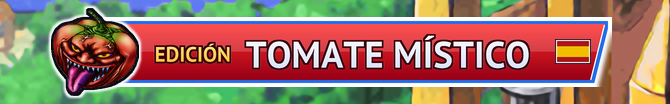

# Yu-Gi-Oh! GX Tag Force 1 — Parcheador europeo (HD + textos corregidos)

[English](README.md) · [Italiano](README.it.md) · [Français](README.fr.md) · [Deutsch](README.de.md) · [Español](README.es.md)

<p align="center"></p>

Un parcheador gratuito y de código abierto para **Yu-Gi-Oh! GX Tag Force** (PSP), versión europea **ULES00600 v1.01**.
A partir de *tu propia* ISO, genera una copia en el idioma elegido (**inglés, francés, alemán, español, italiano**), con las partes que selecciones:

- **texturas HD** para PPSSPP: cartas grandes y pequeñas con el texto redibujado en tu idioma, textos de la interfaz, banner del título;
- **readaptación y corrección de los textos**: donde la localización había perdido o cambiado el significado del original, los diálogos, las frases de los duelos y los textos de la interfaz se readaptan y se traducen de nuevo desde el idioma original (incluidas frases que faltaban por completo en algunos idiomas), además de erratas, acentos, espacios y restos de otros idiomas;
- **corrección de los textos de las cartas**: nombres y descripciones readaptados donde la traducción era errónea o incompleta, además de erratas y acentos;
- **eliminación de los demás idiomas**: ISO más ligera, el juego se queda en el idioma elegido sea cual sea el idioma del sistema de la PSP, y el selector de idioma (pantalla del primer arranque y entrada del menú principal) desaparece porque sería inútil.


Textos modificados por el parche en cada idioma (contados comparando la ISO parcheada con la original; las cifras incluyen cada cambio, desde una letra errónea hasta una frase traducida de nuevo desde cero):

| Idioma | Cartas | Líneas de diálogo | Frases de duelo (únicas) | Textos de interfaz (únicos) |
|---|---:|---:|---:|---:|
| Inglés | 82 | 402 | 11 | 57 |
| Francés | 266 | 467 | 51 | 254 |
| Alemán | 258 | 1,649 | 40 | 581 |
| Español | 624 | 601 | 55 | 329 |
| Italiano | 181 | 2,488 | 33 | 298 |


Texturas HD por idioma. Para francés, alemán, español e italiano **cada una de las cartas del juego (las 2.833) se redibuja en HD con su texto en tu idioma, tanto en la versión grande como en la pequeña**, junto con las páginas de miniaturas del deck, la tabla de atributos y la etiqueta Mágica/Trampa. Las texturas de la interfaz también se redibujan en HD:

| Idioma | Cartas grandes | Cartas pequeñas | Páginas de miniaturas del deck | Texturas de la interfaz y de las escenas (total) | de ellas redibujadas por nosotros |
|---|---:|---:|---:|---:|---:|
| Inglés | 2.833 | 2.833 | – | 3.110 | 50 |
| Francés | 2.833 | 2.833 | 7 | 3.107 | 93 |
| Alemán | 2.833 | 2.833 | 7 | 3.110 | 106 |
| Español | 2.833 | 2.833 | 7 | 3.111 | 95 |
| Italiano | 2.833 | 2.833 | 7 | 3.213 | 113 |

Los cinco idiomas tienen las 2.833 cartas en HD, grandes y pequeñas. Para el inglés vienen del pack de MikeyMK y chrisfand, y 87 las regeneramos nosotros porque corregimos su texto. «Texturas de la interfaz y de las escenas» cuenta cada otra textura HD que usa el idioma (menús, tienda, mapa, personajes...: la base compartida más el módulo del idioma); «de ellas redibujadas por nosotros» son las dibujadas para ese idioma, que para el inglés son las 50 que el pack no cubre. Las texturas idénticas en todos los idiomas vienen de la base compartida.

> **Estado: primera versión.** Los parches están verificados archivo por archivo para cada combinación de módulos, y los cinco idiomas se probaron en PPSSPP (arranque, pantalla de título, duelos de demostración). El modo historia, el editor de mazos y la tienda aún no se han jugado a fondo. El instalador gráfico es nuevo: probado en Windows; la versión de Linux la genera GitHub Actions y aún no se ha ejecutado en un escritorio Linux real.

## Qué necesitas

- Tu propia ISO **ULES00600 v1.01** (europea). MD5 del volcado completo: `719c99478032a4210ae877832061e9fd` ([redump.org](http://redump.org/)). También se aceptan copias sin los últimos 2 KB de ceros.
- [PPSSPP](https://www.ppsspp.org/) con **Reemplazar texturas** activado; se recomienda resolución de renderizado 4x.

Este repositorio **no contiene** el juego ni datos extraídos de él: los parches (`.tfp`) solo contienen diferencias binarias respecto a los archivos originales.

## Instalador gráfico (recomendado)

1. Descarga desde la página de [Releases](../../releases) `tfpatch-gui.exe` (Windows) o `tfpatch-gui-linux-x86_64` (Linux; antes ejecuta `chmod +x tfpatch-gui-linux-x86_64`).
2. Ejecútalo. El programa se abre en el idioma de tu PC (inglés si no es uno de los cinco) y muestra el banner *Tomate Místico* del **idioma del parche**, que por defecto es el mismo que el del programa pero se puede cambiar por separado.
3. El programa busca por sí solo tu ISO y tu carpeta de datos de PPSSPP y solo muestra el resultado; si no encuentra alguna, te pide que la elijas. Deja o quita la marca de los módulos (todos están activados por defecto). Las rutas, la ubicación de la ISO final y una nueva búsqueda están en **Opciones avanzadas**. El **tamaño final de la ISO y el del pack de texturas se muestran en tiempo real** y cambian al marcar o desmarcar módulos.
4. Pulsa **Instalar**. El parche y los módulos de texturas se descargan de las Releases y se verifican (SHA-256); tu ISO original nunca se modifica.

**Aviso de Windows:** el programa no está firmado digitalmente, así que Windows SmartScreen puede mostrar «Windows protegió su PC» y algún antivirus puede marcarlo. Pulsa **Más información → Ejecutar de todas formas**. El código es público y los archivos de las Releases los compila GitHub Actions a partir de él.

Notas sobre las opciones:
- Sin *Quitar los demás idiomas del juego*, el juego conserva los cinco idiomas y su propio selector; solo el idioma del parche recibe las correcciones y las texturas HD.
- *Texturas HD* crea un `textures.zip` aparte en `<carpeta de datos de PPSSPP>/PSP/TEXTURES/ULES00600/` (el mismo archivo sirve en Android: cópialo a la misma ruta en el teléfono). Si esa carpeta ya contiene otro pack de texturas, muévelo antes a otro sitio.

## Línea de comandos

La herramienta de línea de comandos no se adjunta a las versiones (a la mayoría le basta el instalador gráfico): compílala con `cd patcher/tfpatch && cargo build --release` (el programa es `target/release/tfpatch`). Parches, descargables desde la página de la versión: `patch_es.tfp`, `patch_en.tfp`, `patch_fr.tfp`, `patch_de.tfp`, `patch_it.tfp`.

```
tfpatch iso --iso ULES00600.iso --patch patch_es.tfp --out ULES00600_es.iso
tfpatch textures --lang es --out textures.zip
```

`tfpatch iso` acepta `--no-cards`, `--no-text` y `--keep-languages` (los tres módulos de arriba, desactivados) y `--dry-run` (imprime el tamaño final de la ISO en bytes). `tfpatch textures` descarga `base.zip` y el módulo del idioma, comprueba su SHA-256 y los une en un único `textures.zip` (pasa una carpeta a `--out` para extraer; con `--source CARPETA` se usan archivos ya descargados). En Linux escribe `./tfpatch`.

## Límites conocidos

- Una partida guardada creada en un idioma distinto al del parche no se reajusta.
- En Linux, el instalador gráfico necesita `libxkbcommon-x11` (X11) o las bibliotecas de Wayland, que la mayoría de los escritorios ya tienen; si no, compila y usa la línea de comandos. Los diálogos de archivo usan el portal del escritorio: si no se abren, escribe las rutas en las opciones avanzadas.
- Solo se admite el emulador PPSSPP (el parche sustituye un módulo del juego en la ISO y las texturas son texturas de reemplazo de PPSSPP).
- La descarga de texturas es de unos 1,4 GB por idioma: una base de 313 MB común a todos los idiomas (solo las texturas que necesitan todos) más un módulo de unos 1 GB con las cartas HD y la interfaz de ese idioma.

## Informar de problemas

¿Has encontrado una errata, un texto de carta incorrecto o un error? [Abre una incidencia](../../issues/new/choose): hay formularios para errores de texto y para problemas del programa, y puedes escribir en cualquiera de los cinco idiomas. No adjuntes nunca tu ISO ni archivos del juego.

## Cómo funciona

1. `patcher/tools/build_modular_patch.py` construye, para cada idioma, la ISO solo con las correcciones de cartas, solo con las de textos y con ambas, y escribe un `.tfp` modular (formato 2): un zip con `patch.json` y diferencias bsdiff, cada una marcada con los módulos que necesita (`cards`, `text`, `strip`).
2. `patcher/tfpatch` (Rust) comprueba el MD5, selecciona las diferencias de los módulos activos y escribe la ISO de forma compacta: misma cabecera y mismos directorios, y después solo los datos que siguen en uso. El tamaño final se calcula sin escribir nada, y así lo muestra el instalador en tiempo real.
3. Con `strip`, se modifica `libtitle.prx` (`patcher/tools/remove_language_selector.py`) para quitar la pantalla y la entrada de menú del idioma y fijar el idioma, y los archivos de los demás idiomas apuntan a los datos del idioma elegido.
4. `patcher/tools/build_texture_modules.py` crea `base.zip` (solo las texturas que necesitan todos los idiomas) y un `<idioma>.zip` por idioma (las texturas que usa ese idioma); `patcher/tools/build_manifest.py` completa `manifest.json` (SHA-256, parches, tamaños de las ISO).
5. `verify_modular_patch.py`, `compare_isos.py` y `verify_texture_pack.py` comprueban los resultados; `build_all_patches.sh IDIOMA...` rehace y verifica cada combinación.

Los textos, las reglas editoriales y las correcciones están en `tools/` (`corrections/`, `data/`). `docs/NEW_LANGUAGE_GUIDE.md`, `docs/EDITORIAL_CHOICES.md` y `docs/CHANGES_<LANG>.md` documentan el método y las decisiones (en italiano).

## Compilar desde el código fuente

```
cd patcher/tfpatch && cargo build --release
```

Compila tanto `tfpatch` (línea de comandos) como `tfpatch-gui`. En Linux, la interfaz gráfica necesita los paquetes de desarrollo habituales de X11/Wayland/OpenGL.

## Privacidad

Los programas no recopilan datos personales ni envían a ningún sitio información sobre ti o tu ordenador: sin telemetría, sin cuentas, sin estadísticas. Tu ISO se lee y se parchea solo en tu propio equipo y nunca sale de él. El único tráfico de red es la descarga del parche y de las texturas desde las Releases de GitHub de este repositorio (con la comprobación SHA-256); como en cualquier descarga desde GitHub, GitHub ve los datos de conexión habituales, como tu dirección IP, según su propia política de privacidad.

## Créditos

- **MikeyMK** — *Yu-Gi-Oh! GX Tag Force 1 HD Remastered* (base de las texturas HD, versión de EE. UU.).
- **chrisfand** — cartas HD.
- Fuentes libres (OFL): XCharter, Libre Baskerville, Newsreader, Alegreya y otras, descargadas con `tools/alt_fonts/download_fonts.sh`.

Proyecto de aficionados no oficial y sin ánimo de lucro, no afiliado a Konami. *Yu-Gi-Oh!* es una marca de Konami.

## Licencia

El código se publica bajo la [licencia MIT](LICENSE). La licencia cubre solo el código: los textos del juego pertenecen a Konami, y las texturas HD se basan en el trabajo de MikeyMK y chrisfand citado arriba.
