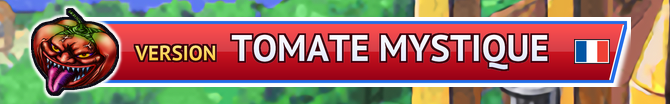

# Yu-Gi-Oh! GX Tag Force 1 — Patcheur européen (HD + textes corrigés)

[English](README.md) · [Italiano](README.it.md) · [Français](README.fr.md) · [Deutsch](README.de.md) · [Español](README.es.md)

<p align="center"></p>

Patcheur gratuit et open source pour **Yu-Gi-Oh! GX Tag Force** (PSP), version européenne **ULES00600 v1.01**.
À partir de *votre propre* ISO, il produit une copie dans la langue choisie (**anglais, français, allemand, espagnol, italien**), avec les parties que vous sélectionnez :

- **textures HD** pour PPSSPP : cartes grandes et petites dont le texte est redessiné dans votre langue, textes de l'interface, bannière du titre ;
- **réadaptation et correction des textes** : partout où la localisation avait perdu ou changé le sens de l'original, dialogues, phrases des duels et textes de l'interface sont réadaptés et retraduits depuis la langue d'origine (y compris des phrases totalement absentes dans certaines langues), en plus des fautes de frappe, accents, espaces et restes d'autres langues ;
- **correction des textes des cartes** : noms et descriptions réadaptés là où la traduction était fausse ou incomplète, plus fautes de frappe et accents ;
- **suppression des autres langues** : ISO plus légère, le jeu reste dans la langue choisie quelle que soit la langue système de la PSP, et le sélecteur de langue (écran du premier démarrage et entrée du menu principal) disparaît car il serait inutile.


Textes modifiés par le patch dans chaque langue (comptés en comparant l'ISO patchée à l'originale ; les chiffres incluent toute modification, d'une lettre erronée à une phrase retraduite de zéro) :

| Langue | Cartes | Lignes de dialogue | Phrases de duel (uniques) | Textes d'interface (uniques) |
|---|---:|---:|---:|---:|
| Anglais | 82 | 402 | 11 | 57 |
| Français | 266 | 467 | 51 | 254 |
| Allemand | 258 | 1,649 | 40 | 581 |
| Espagnol | 624 | 601 | 55 | 329 |
| Italien | 181 | 2,488 | 33 | 298 |


Textures HD par langue. Pour le français, l'allemand, l'espagnol et l'italien, **chaque carte du jeu sans exception (les 2 833) est redessinée en HD avec son texte dans votre langue, en version grande comme en version petite**, avec les pages de miniatures du deck, la table des attributs et l'étiquette Magie/Piège. Les textures de l'interface sont elles aussi redessinées en HD :

| Langue | Grandes cartes | Petites cartes | Pages de miniatures du deck | Textures de l'interface et des scènes (total) | dont redessinées par nous |
|---|---:|---:|---:|---:|---:|
| Anglais | 2 833 | 2 833 | – | 3 110 | 50 |
| Français | 2 833 | 2 833 | 7 | 3 107 | 93 |
| Allemand | 2 833 | 2 833 | 7 | 3 110 | 106 |
| Espagnol | 2 833 | 2 833 | 7 | 3 111 | 95 |
| Italien | 2 833 | 2 833 | 7 | 3 213 | 113 |

Les cinq langues ont les 2 833 cartes en HD, grandes et petites. Pour l'anglais elles viennent du pack de MikeyMK et chrisfand, et 87 sont régénérées par nous car nous avons corrigé leur texte. « Textures de l'interface et des scènes » compte toutes les autres textures HD utilisées par la langue (menus, boutique, carte, personnages... : la base partagée plus le module de la langue) ; « dont redessinées par nous » sont celles dessinées pour cette langue, soit pour l'anglais les 50 que le pack ne couvre pas. Les textures identiques dans toutes les langues viennent de la base partagée.

> **État : première version.** Les patchs sont vérifiés fichier par fichier pour chaque combinaison de modules, et les cinq langues ont été testées dans PPSSPP (démarrage, écran titre, duels de démonstration). Le mode histoire, l'éditeur de deck et la boutique n'ont pas encore été joués à fond. L'installateur graphique est nouveau : testé sous Windows ; la version Linux est produite par GitHub Actions et n'a pas encore été lancée sur un vrai bureau Linux.

## Ce qu'il vous faut

- Votre propre ISO **ULES00600 v1.01** (européenne). MD5 du dump complet : `719c99478032a4210ae877832061e9fd` ([redump.org](http://redump.org/)). Les copies sans les 2 derniers Ko de zéros sont aussi acceptées.
- [PPSSPP](https://www.ppsspp.org/) avec **Remplacer les textures** activé ; résolution de rendu 4x recommandée.

Ce dépôt **ne contient pas** le jeu ni de données extraites du jeu : les patchs (`.tfp`) ne contiennent que des différences binaires par rapport aux fichiers d'origine.

## Installateur graphique (recommandé)

1. Téléchargez depuis la page [Releases](../../releases) `tfpatch-gui.exe` (Windows) ou `tfpatch-gui-linux-x86_64` (Linux ; lancez d'abord `chmod +x tfpatch-gui-linux-x86_64`).
2. Lancez-le. Le programme s'ouvre dans la langue de votre PC (anglais si ce n'en est pas une des cinq) et affiche la bannière *Tomate Mystique* de la **langue du patch**, identique par défaut à celle du programme mais modifiable séparément.
3. Le programme cherche tout seul votre ISO et votre dossier de données PPSSPP et n'affiche que le résultat ; s'il n'en trouve pas un, il vous demande de le choisir. Laissez ou décochez les modules (tous sont activés par défaut). Les chemins, l'emplacement de l'ISO finale et une nouvelle recherche se trouvent dans **Options avancées**. La **taille finale de l'ISO et celle du pack de textures s'affichent en direct** et changent quand vous cochez ou décochez des modules.
4. Cliquez sur **Installer**. Le patch et les modules de textures sont téléchargés depuis les Releases et vérifiés (SHA-256) ; votre ISO d'origine n'est jamais modifiée.

**Avertissement Windows :** le programme n'est pas signé numériquement ; Windows SmartScreen peut afficher « Windows a protégé votre ordinateur » et certains antivirus peuvent le signaler. Cliquez sur **Informations complémentaires → Exécuter quand même**. Le code est public et les fichiers des Releases sont compilés à partir de celui-ci par GitHub Actions.

Remarques sur les options :
- Sans *Retirer les autres langues du jeu*, le jeu garde ses cinq langues et son sélecteur ; seule la langue du patch reçoit les corrections et les textures HD.
- *Textures HD* crée un `textures.zip` séparé dans `<dossier de données PPSSPP>/PSP/TEXTURES/ULES00600/` (le même fichier fonctionne sur Android : copiez-le au même chemin sur le téléphone). Si ce dossier contient déjà un autre pack de textures, déplacez-le d'abord.

## Ligne de commande

L'outil en ligne de commande n'est pas joint aux versions (l'installateur graphique suffit à la plupart des gens) : compilez-le avec `cd patcher/tfpatch && cargo build --release` (le programme est `target/release/tfpatch`). Patchs, à télécharger sur la page de la version : `patch_fr.tfp`, `patch_en.tfp`, `patch_de.tfp`, `patch_es.tfp`, `patch_it.tfp`.

```
tfpatch iso --iso ULES00600.iso --patch patch_fr.tfp --out ULES00600_fr.iso
tfpatch textures --lang fr --out textures.zip
```

`tfpatch iso` accepte `--no-cards`, `--no-text` et `--keep-languages` (les trois modules ci-dessus, désactivés) et `--dry-run` (affiche la taille finale de l'ISO en octets). `tfpatch textures` télécharge `base.zip` et le module de la langue, vérifie leur SHA-256 et les fusionne en un seul `textures.zip` (donnez un dossier à `--out` pour extraire ; avec `--source DOSSIER`, on utilise des fichiers déjà téléchargés). Sous Linux, tapez `./tfpatch`.

## Limites connues

- Une sauvegarde créée dans une autre langue que celle du patch n'est pas réalignée.
- Sous Linux, l'installateur graphique demande `libxkbcommon-x11` (X11) ou les bibliothèques Wayland, que la plupart des bureaux ont déjà ; sinon, compilez et utilisez la ligne de commande. Les fenêtres de choix de fichier passent par le portail du bureau : si elles ne s'ouvrent pas, saisissez les chemins dans les options avancées.
- Seul l'émulateur PPSSPP est pris en charge (le patch remplace un module du jeu dans l'ISO et les textures sont des textures de remplacement PPSSPP).
- Le téléchargement des textures est d'environ 1,4 Go par langue : une base de 313 Mo commune à toutes les langues (seulement les textures utiles à toutes) plus un module d'environ 1 Go avec les cartes HD et l'interface de cette langue.

## Signaler un problème

Une faute de frappe, un texte de carte erroné ou un bug ? [Ouvrez un ticket](../../issues/new/choose) : il existe des formulaires pour les erreurs de texte et pour les problèmes du programme, et vous pouvez écrire dans l'une des cinq langues. Ne joignez jamais votre ISO ni des fichiers du jeu.

## Fonctionnement

1. `patcher/tools/build_modular_patch.py` construit, pour chaque langue, l'ISO avec seulement les corrections des cartes, seulement celles des textes, et les deux, puis écrit un `.tfp` modulaire (format 2) : un zip avec `patch.json` et des deltas bsdiff, chacun étiqueté avec les modules dont il a besoin (`cards`, `text`, `strip`).
2. `patcher/tfpatch` (Rust) vérifie le MD5, sélectionne les deltas des modules actifs et écrit l'ISO sous forme compacte : mêmes en-tête et répertoires, puis seulement les données encore utilisées. La taille finale est calculée sans rien écrire, ce qui permet à l'installateur de l'afficher en direct.
3. Avec `strip`, `libtitle.prx` est modifié (`patcher/tools/remove_language_selector.py`) pour supprimer l'écran et l'entrée de menu de langue et fixer la langue, et les fichiers des autres langues pointent vers les données de la langue choisie.
4. `patcher/tools/build_texture_modules.py` crée `base.zip` (seulement les textures utiles à toutes les langues) et un `<langue>.zip` par langue (les textures utilisées par cette langue) ; `patcher/tools/build_manifest.py` complète `manifest.json` (SHA-256, patchs, tailles des ISO).
5. `verify_modular_patch.py`, `compare_isos.py` et `verify_texture_pack.py` contrôlent les résultats ; `build_all_patches.sh LANGUE...` refait et vérifie chaque combinaison.

Les textes, les règles éditoriales et les corrections se trouvent dans `tools/` (`corrections/`, `data/`). `docs/NEW_LANGUAGE_GUIDE.md`, `docs/EDITORIAL_CHOICES.md` et `docs/CHANGES_<LANG>.md` documentent la méthode et les choix (en italien).

## Compiler depuis les sources

```
cd patcher/tfpatch && cargo build --release
```

Cela compile `tfpatch` (ligne de commande) et `tfpatch-gui`. Sous Linux, l'interface graphique demande les paquets de développement habituels X11/Wayland/OpenGL.

## Crédits

- **MikeyMK** — *Yu-Gi-Oh! GX Tag Force 1 HD Remastered* (base des textures HD, version US).
- **chrisfand** — cartes HD.
- Polices libres (OFL) : XCharter, Libre Baskerville, Newsreader, Alegreya et d'autres, téléchargées par `tools/alt_fonts/download_fonts.sh`.

Projet de fans non officiel et sans but lucratif, non affilié à Konami. *Yu-Gi-Oh!* est une marque de Konami.

## Licence

Le code est publié sous [licence MIT](LICENSE). La licence ne couvre que le code : les textes du jeu appartiennent à Konami, et les textures HD s'appuient sur le travail de MikeyMK et chrisfand cité ci-dessus.
